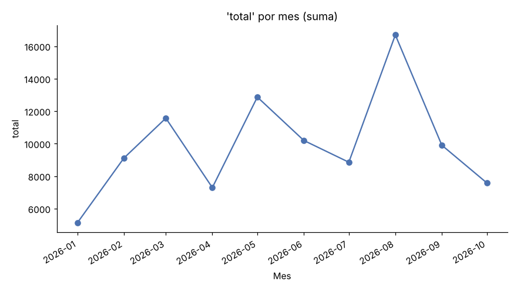
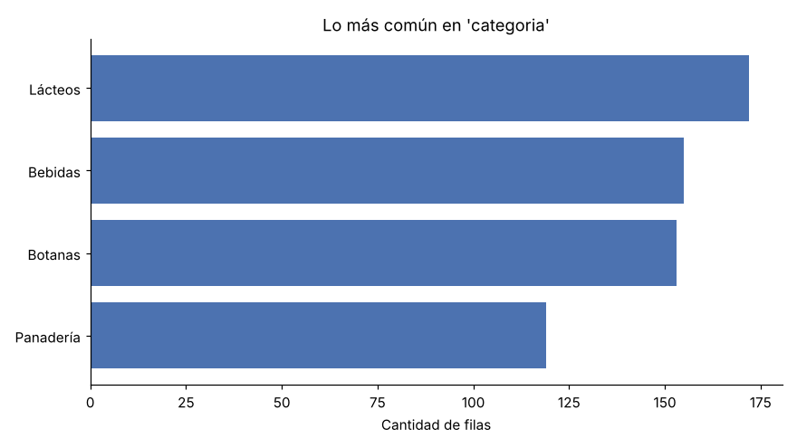

<h1 align="center">¡Hola! Soy Abel 👋</h1>

  

---

### 🙋‍♂️ Sobre mí

- 🔭 Actualmente trabajo en mis primeros proyectos.
- 🌱 Estoy aprendiendo programación y desarrollo web.
- 💬 Pregúntame lo que quieras, ¡con gusto platico!
- ⚡ Dato curioso: mi usuario tiene muchas "l" 😄

### 🛠️ Tecnologías que uso o estoy aprendiendo

  

### 📊 Estadísticas

  
  

  

### 📂 Proyectos

#### 📊 [Analizador de datos](analisis_datos/)

Le das un archivo CSV o Excel y te regresa un reporte en español con los hallazgos más importantes, estadísticas y gráficas.

- 🐍 Hecho con **Python**, **pandas** y **matplotlib**
- 🧹 Limpia los datos solo: duplicados, celdas vacías, `"$1,200"` → `1200`, fechas en texto
- 🔒 Tus datos reales nunca se suben a GitHub
- 👉 [Ver un reporte de ejemplo](analisis_datos/resultados/ventas_ejemplo/REPORTE.md)

  
  

### 📫 Contacto

- 💬 Escríbeme abriendo un [issue en este repositorio](https://github.com/abelllllllllll/abelllllllllll/issues)
- 🐙 GitHub: [@abelllllllllll](https://github.com/abelllllllllll)

  

