# 📊 Reporte de análisis: `ventas_ejemplo`
_Generado el 13/11/2026 a las 11:43_

## 1. Lo más importante

- ⚠️ A la columna **metodo_pago** le faltan datos en el 7% de las filas.
- 📅 Los datos van del **01/01/2026** al **27/10/2026** (299 días).
- 🔢 **piezas**: en promedio 4.14, va de 1 a 8.
- 🔢 **precio_unitario**: en promedio 41.31, va de 8 a 250.
  - El promedio (41.31) es muy distinto a la mediana (18): hay algunos valores muy altos que jalan el promedio.
- 🔢 **total**: en promedio 165.58, va de 8 a 2,000.
  - El promedio (165.58) es muy distinto a la mediana (75): hay algunos valores muy altos que jalan el promedio.
- 🏷️ En **producto** lo más común es **Pan** (12% de las filas).
- 🏷️ En **categoria** lo más común es **Lácteos** (29% de las filas).
- 🏷️ En **ciudad** lo más común es **CDMX** (41% de las filas).
- 🏷️ En **metodo_pago** lo más común es **Efectivo** (46% de las filas).
- 🔗 Cuando **precio_unitario** sube, **total** también sube (relación de 0.85).

## 2. ¿Qué hay en los datos?

- **Filas:** 599
- **Columnas:** 8
- **Numéricas:** `piezas`, `precio_unitario`, `total`
- **De texto:** `producto`, `categoria`, `ciudad`, `metodo_pago`
- **De fecha:** `fecha`

## 3. Limpieza que se hizo

- Se quitaron 13 filas repetidas.
- La columna 'fecha' se convirtió a fecha.
- La columna 'precio_unitario' se convirtió a número.

## 4. Datos faltantes

| Columna | Celdas vacías | % |
|---|---|---|
| metodo_pago | 39 | 6.5% |

## 5. Estadísticas de las columnas numéricas

| Columna | Datos | Suma | Promedio | Mediana | Mínimo | Máximo | Variación (desv. est.) |
|---|---|---|---|---|---|---|---|
| **piezas** | 599 | 2,480 | 4.14 | 4 | 1 | 8 | 1.98 |
| **precio_unitario** | 599 | 24,745 | 41.31 | 18 | 8 | 250 | 64.19 |
| **total** | 599 | 99,180 | 165.58 | 75 | 8 | 2,000 | 286.59 |

## 6. Valores más comunes en columnas de texto

**producto** (11 valores distintos)

- Pan: 70
- Yogurt: 62
- Refresco: 55
- Leche: 55
- Queso: 55

**categoria** (4 valores distintos)

- Lácteos: 172
- Bebidas: 155
- Botanas: 153
- Panadería: 119

**ciudad** (4 valores distintos)

- CDMX: 246
- Guadalajara: 170
- Monterrey: 97
- Puebla: 86

**metodo_pago** (3 valores distintos)

- Efectivo: 274
- Transferencia: 148
- Tarjeta: 138

## 7. Gráficas

### Distribución de piezas

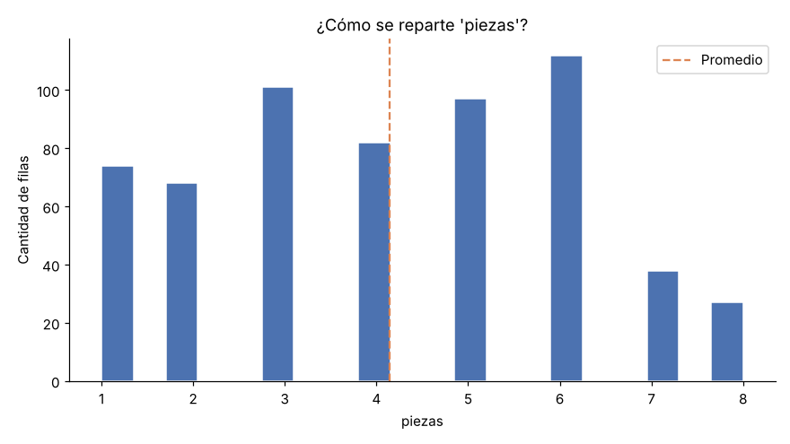

### Distribución de precio_unitario

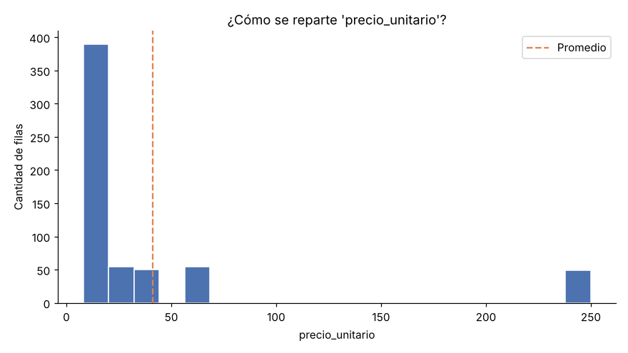

### Distribución de total

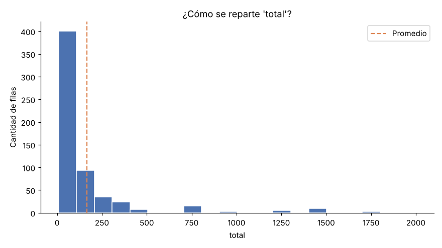

### Valores más comunes de producto

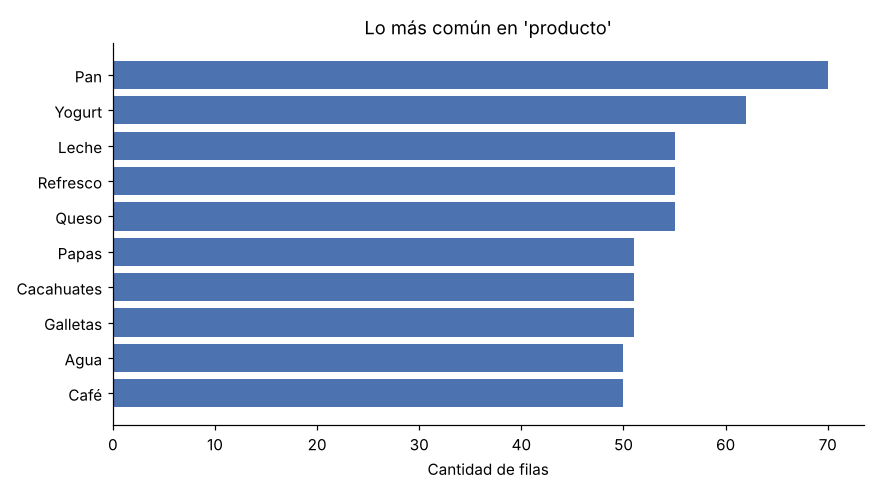

### Valores más comunes de categoria

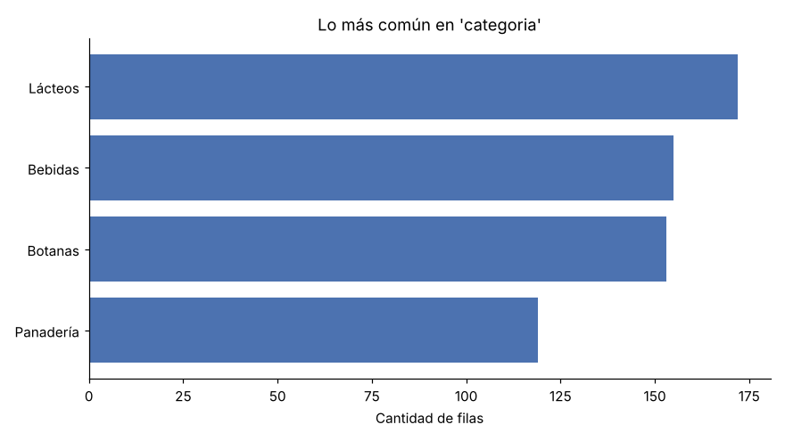

### Valores más comunes de ciudad

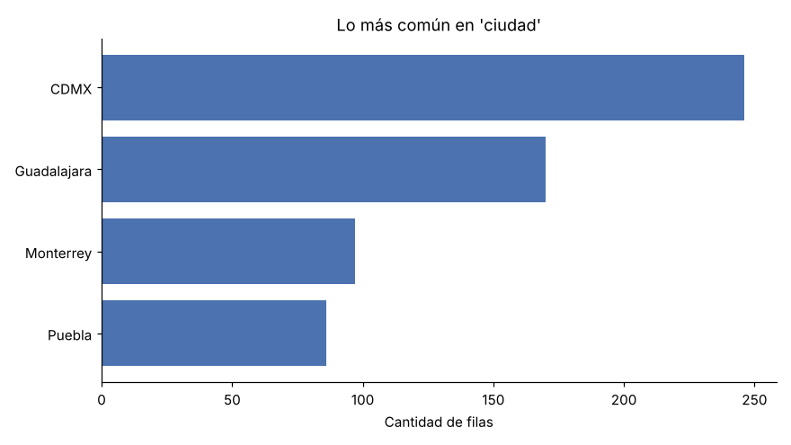

### Valores más comunes de metodo_pago

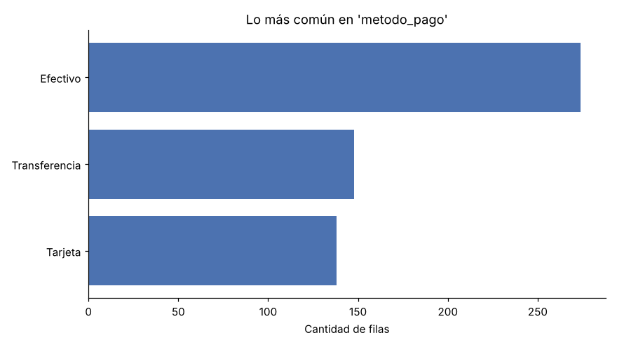

### piezas a lo largo del tiempo

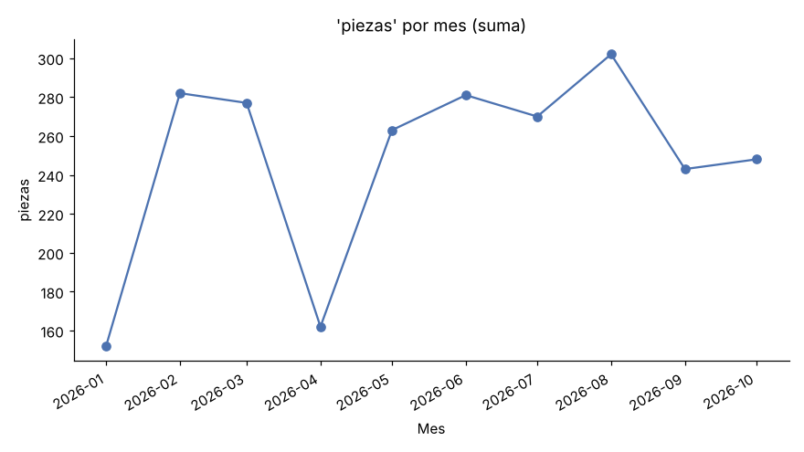

### precio_unitario a lo largo del tiempo

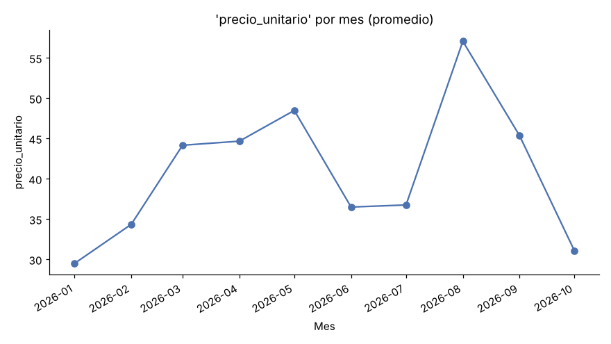

### total a lo largo del tiempo

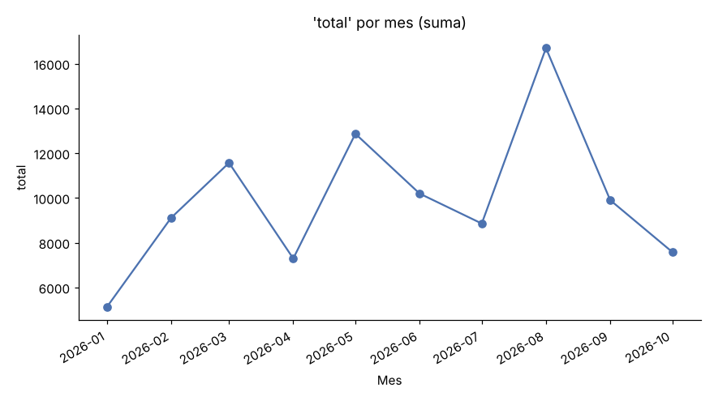

### Relación entre columnas numéricas

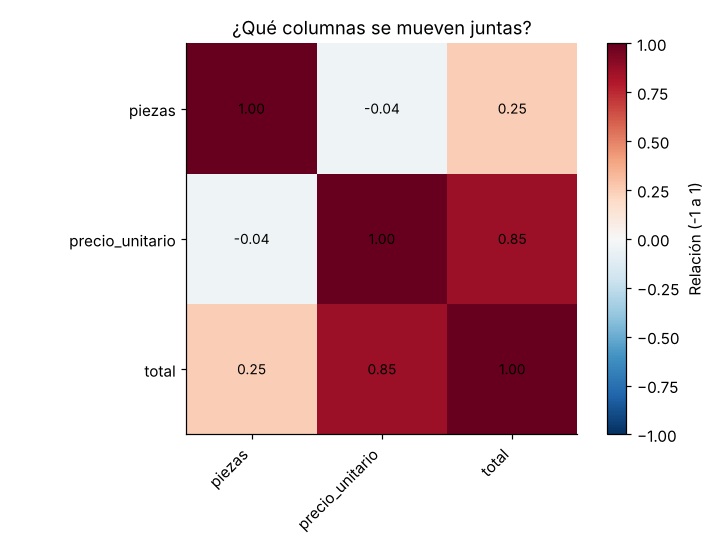

---
💡 ¿No entiendes algún término? Revisa el glosario en el `README.md` del proyecto.