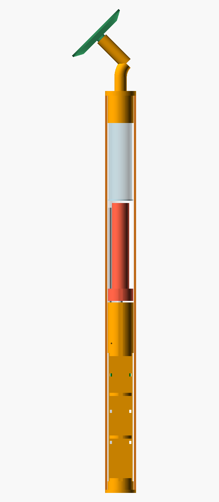
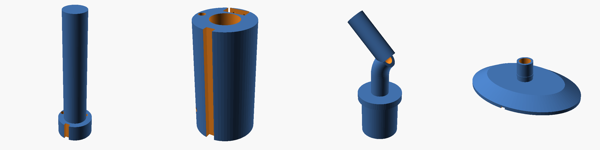

# 🧴 Aplicador de crema motorizado

Prototipo casero para aplicarse crema espesa (emoliente para piel sensible) en todo el cuerpo, espalda incluida, **sin ayuda de otra persona**.

Es un mango de PVC de unos 60 cm con una paleta blanda en la punta. Dentro, un pequeño motor empuja el émbolo de una jeringa de 60 ml llena de crema, como una pistola de silicona en miniatura. Con un botón sale una dosis o crema continua.

## Características

- **Pulsación corta:** dosis fija (2 ml, ajustable). **Mantener:** sale crema mientras lo mantengas. **Pulsar durante una dosis:** la cancela.
- **Antigoteo:** al terminar, el motor retrocede un instante para que no siga saliendo crema.
- **Apagado automático** a los 2 minutos sin uso; se despierta con un botón.
- **Batería** de una celda 18650 que se carga por USB-C, con aviso de batería baja.
- Sabe cuándo está **vacía la jeringa**, y las jeringas se cambian como cartuchos.
- Todo funciona a **3–4,2 V**. Nada calienta.
- Coste: **≈ 55 €** en piezas.

## Contenido

| Carpeta | Qué hay |
|---|---|
| [`docs/01_materiales.md`](docs/01_materiales.md) | Lista de materiales con precios y qué buscar |
| [`docs/02_esquema_conexiones.md`](docs/02_esquema_conexiones.md) | Esquema eléctrico explicado paso a paso |
| [`docs/03_montaje_mecanico.md`](docs/03_montaje_mecanico.md) | Impresión 3D, cortes, taladros y montaje |
| [`docs/04_uso_calibracion_limpieza.md`](docs/04_uso_calibracion_limpieza.md) | Cargar firmware, uso, calibración y limpieza |
| [`docs/05_precauciones.md`](docs/05_precauciones.md) | Seguridad eléctrica, calor, agua, piel |
| `firmware/aplicador_crema/` | Firmware para Arduino IDE (ESP32-C3), comentado en español |
| `firmware/pruebas/` | Simulador que prueba el firmware en el PC (16 pruebas) |
| `mecanica/aplicador.scad` | Diseño paramétrico en OpenSCAD + STL listos en `mecanica/stl/` |
| `calculos/hidraulica.py` | Cálculo de presión y fuerza: por qué jeringa y no bomba peristáltica |

## Qué está verificado y qué no

**Verificado sin el aparato físico:**
- El firmware **compila para ESP32-C3** (Arduino-ESP32 3.1.3) sin errores ni avisos.
- El firmware pasa **16/16 pruebas** en un simulador que imita botones con rebotes, motor, husillo, jeringa, batería, memoria y sueño profundo.
- Las 7 piezas 3D **se generan sin errores**, y el diseño comprueba solo que no haya interferencias entre piezas.
- El cálculo hidráulico cubre cremas desde loción espesa hasta bálsamo denso.

**Pendiente de comprobar con las piezas reales:** las medidas exactas de tu jeringa, tubo y motor (se ajustan en el `.scad`), la viscosidad de tu crema y la calibración de la dosis (10 minutos, explicada en la documentación).

