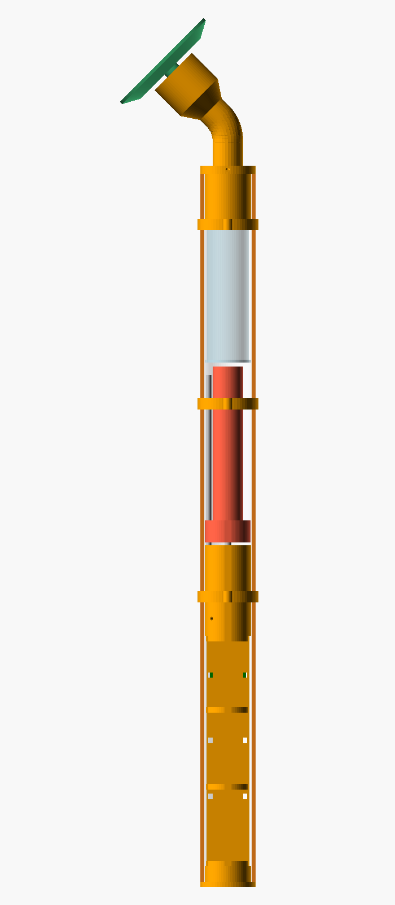
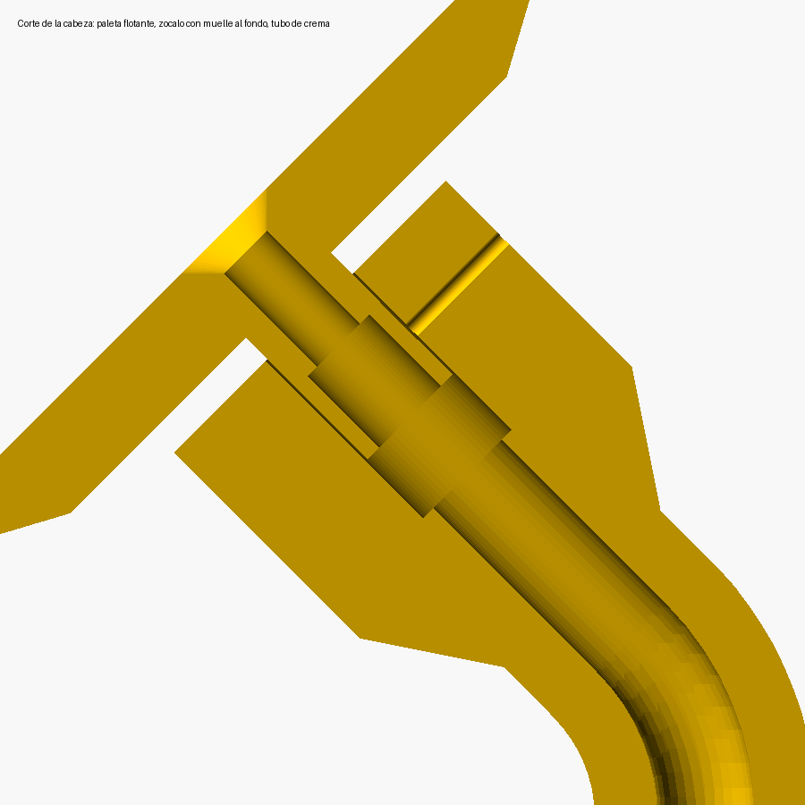

# 3. Montaje mecánico



De abajo arriba: **tapa inferior** (USB-C e interruptor) → **trineo** con el TP4056, la batería y la placa → **soporte del motor** (N20, acoplador, rodamiento y final de carrera) → **carro con tubo empujador** → **jeringa de 60 ml** → **tapa superior con brazo a 45° y cabeza con sensor** → **paleta flotante**.

## Cabeza con sensor de contacto



- La **paleta flotante** entra por su cuello en el zócalo de la cabeza, apoyada sobre un **muelle** que la empuja hacia fuera. En reposo queda **3 mm** separada de la cabeza.
- Un **tornillo M2** atraviesa la pared de la cabeza y entra en una **ranura** del cuello. Así la paleta no se sale, no gira y no se hunde más de 3 mm.
- Al apoyar la paleta en la piel con una fuerza suave (≈ 1–2 N, como apoyar un cepillo), se hunde y su cara trasera aprieta la palanca del **microinterruptor estanco**, alojado en la cara de la cabeza.
- El tubo de crema pasa por dentro del muelle y entra 10 mm a presión en el cuello. Los 3 mm de recorrido los absorbe el propio tubo sin problema.
- El cable del interruptor baja por un canal propio dentro del brazo, separado del de la crema, y sale por un lateral del collarín.

## Cómo funciona el empujador

Se quita el vástago (la varilla con el disco para el pulgar) del émbolo de la jeringa y se deja **solo el tapón de goma** dentro. Lo empuja un **tubo hueco impreso** que forma parte del carro. Al avanzar, la varilla roscada M5 se va metiendo dentro de ese tubo hueco. Así cabe todo en línea dentro de un tubo de Ø40.

El empuje se transmite así: tapón → crema → hombro de la jeringa → tapa superior → tornillo M4 → tubo de PVC. En el otro sentido: carro → tuercas → varilla M5 → rodamiento 625 → escalón del soporte → tornillos M3 → tubo de PVC. **El motor no recibe empuje axial**, solo par.

## Archivo OpenSCAD

`mecanica/aplicador.scad` es paramétrico. **Antes de imprimir, mide con el pie de rey tu tubo, tu jeringa, tu motor y tu acoplador**, y corrige la sección `MEDIDAS`. Al renderizar, la consola de OpenSCAD te dice:

```
=== CORTAR TUBO PVC Ø40 A: 511 mm
=== VARILLA M5 INOX: 153 mm   VARILLA GUÍA Ø4: 134 mm
=== RECORRIDO_MAX_MM para el firmware: 106
=== AGUJEROS EN EL PVC (desde el extremo de abajo): DOSIS Ø12 a 165 mm, LED Ø5 a 152 mm, RETRAER Ø12 a 140 mm
```

Además lleva comprobaciones automáticas (`assert`) que avisan si alguna medida hace que dos piezas choquen.

Los STL ya generados con las medidas típicas están en `mecanica/stl/`.

## Impresión

| Pieza | Material | Orientación | Notas |
|---|---|---|---|
| `soporte_motor` | PETG | De pie, como está | 5 perímetros, 40 % de relleno |
| `carro` | PETG | De pie, con el tubo hacia arriba | 6 perímetros (las tuercas M5 van a presión) |
| `tapa_superior` | PETG | Tumbada de lado | Con soportes, por el codo del brazo |
| `trineo` | PETG | Con la bandeja apoyada en la cama | — |
| `tapa_inferior` | PETG | Con el reborde abajo | — |
| `paleta` | **TPU 95A** | Con la cara de aplicación abajo | 3 perímetros, 25 % de relleno; queda blanda |
| `plantilla_taladro` | PLA o PETG | — | Solo sirve para marcar los agujeros |
| `pinza_cable` (×3) | PETG | De pie | Sujetan el cable del sensor por fuera del tubo |

## Pasos

1. **Tubo:** córtalo a la medida que indica OpenSCAD (≈ 511 mm), recto, y lija las rebabas. Apoya la plantilla en el extremo de abajo, marca y taladra: botones Ø12, LED Ø5, y luego los agujeros de los tornillos (M3 Ø2,6 y M4 Ø4,4) presentando cada pieza en su sitio.
2. **Jeringas (cartuchos):** recorta las aletas en círculo de Ø33 mm, con cúter y lima. Saca el vástago del émbolo girándolo y tirando: el tapón de goma se queda dentro. **Guarda un vástago** para colocar el tapón al rellenar.
3. **Soporte del motor:**
   - Mete el N20 desde abajo (va justo de medida; una gota de pegamento si queda flojo) y pon el acoplador en su eje.
   - Pasa la varilla M5 desde arriba por el escalón y rósca una tuerca por debajo, que queda en la cámara del acoplador. Mete el rodamiento 625 desde arriba hasta que apoye en el escalón, y encima pon arandela y tuerca M5. **Aprieta las dos tuercas contra el rodamiento**: la varilla debe girar con el aro interior sin holgura arriba-abajo.
   - Mete el extremo de la varilla en el acoplador y aprieta los prisioneros.
   - Pega la varilla guía Ø4 en su agujero ciego con epoxi, bien vertical.
   - Atornilla el microinterruptor (M2) en su rebaje, con la palanca hacia arriba.
4. **Carro:** mete una tuerca M5 a presión en cada hexágono, de arriba y de abajo (con calor del soldador si cuesta). Enróscalo en la varilla, con la guía pasando por su agujero.
5. **Lubrica** la varilla con grasa de silicona.
6. **Trineo:** sujeta con bridas el portapilas, el TP4056 (con el USB-C hacia abajo, alineado con la ventana de la tapa) y la placa. Pasa los cables por el canal de la pared.
7. **Montaje en el tubo:** monta los botones y el LED en el tubo. Mete el trineo y la tapa inferior por abajo, y el soporte del motor con el carro por arriba, hasta su sitio. Fíjalos con los M3.
8. **Tapa superior y sensor:**
   - Pasa los cables del microinterruptor por su canal del brazo, empujándolos desde la cabeza hasta que salgan por el lateral del collarín. Si cuesta, guíalos con un alambre fino.
   - Mete el microinterruptor en su alojamiento con la palanca hacia fuera y fíjalo con una gota de silicona neutra o epoxi.
   - Pasa el tubo de silicona por el canal central del brazo (con jabón entra mejor) y deja que asome unos 15 mm por cada lado.
   - Mete el muelle en el fondo del zócalo y el tubo de silicona 10 mm en el cuello de la paleta. Empuja la paleta en el zócalo, con la ranura del cuello hacia el agujero del M2, y enrosca el tornillo M2 hasta que toque. Luego **aflójalo media vuelta**: la paleta debe deslizar suave y volver sola.
   - **Ajuste:** con la paleta en reposo, el interruptor **no** debe hacer clic. Al hundirla unos 2 mm, sí. Si no hace clic, dobla un poco la palanca hacia fuera. Si hace clic sin apoyar, dóblala hacia dentro.
9. **Cable por fuera:** baja el cable por la cara trasera del tubo (la opuesta a los botones) con las 3 pinzas y mételo por el agujero de Ø4 (ver `02_esquema_conexiones.md`).

## Cambiar o rellenar la jeringa

1. Pulsa **RETRAER** y espera a que el carro llegue atrás del todo (≈ 90 s; el LED queda fijo mientras se mueve).
2. Quita el tornillo M4 con la mariposa y saca la tapa superior: el tubo de silicona sale con ella. Apártala a un lado; el cable del sensor tiene holgura para ello. Saca la jeringa.
3. **Rellenar:** saca el tapón de goma con el vástago guardado. Llena el cuerpo por detrás con una espátula o una manga pastelera desechable, dando golpecitos para que no queden burbujas. Mete el tapón con el vástago, pasando un alambre fino entre el tapón y la pared para que escape el aire. Empuja hasta que asome crema por la punta y quita el vástago.
4. Mete la jeringa con la punta hacia arriba, conecta el tubo de silicona, pon la tapa y el tornillo.
5. La primera dosis tarda un poco: el empujador recorre unos 2 mm hasta tocar el tapón.

Lo más práctico es tener **2–3 jeringas llenas** en la nevera o en un cajón, tapadas con su capuchón, y cambiarlas como si fueran cartuchos.
