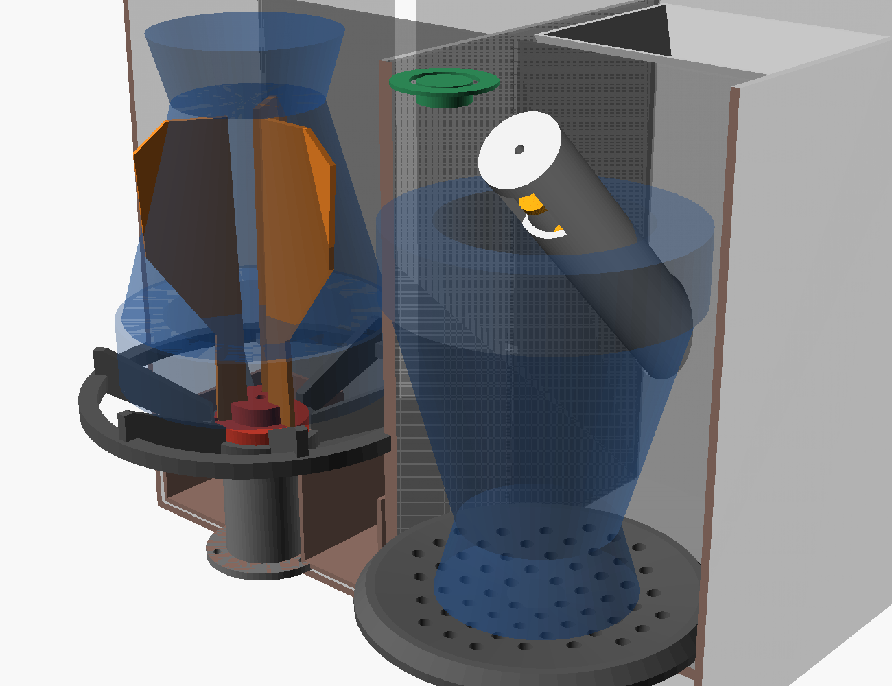
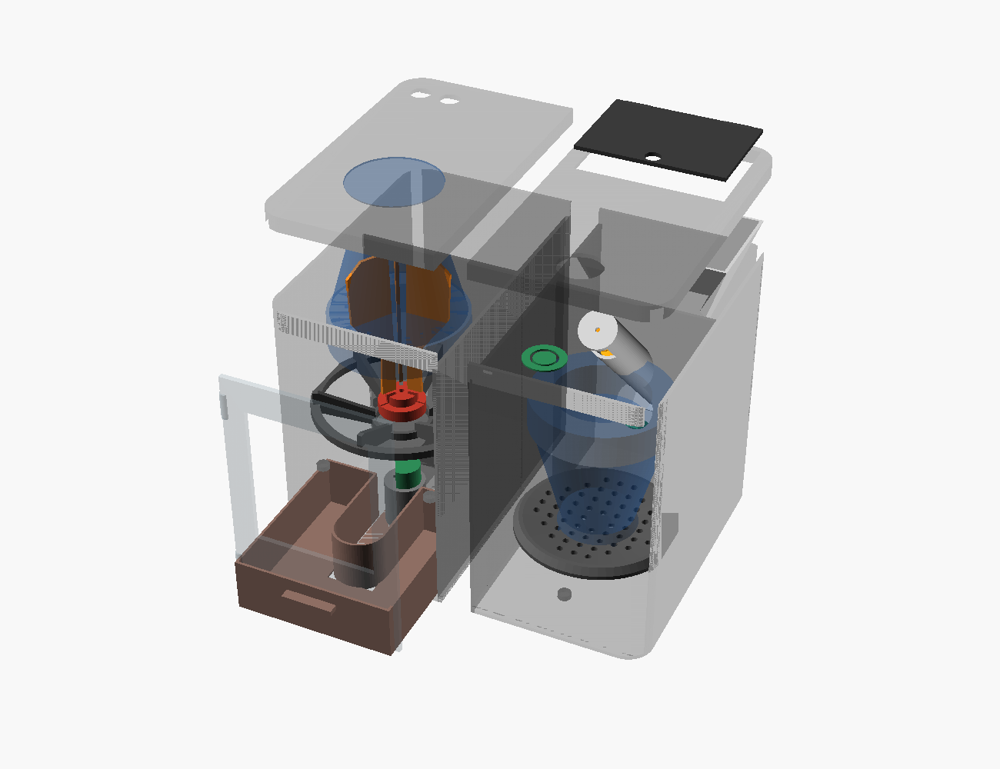

# 🧉 Dispositivo automático de mate (MVP)

Plan de desarrollo del primer prototipo funcional.

> Estado: **equipo v1 genérico diseñado** (todas las piezas, lista de materiales, conexiones y firmware).
> **Nada está probado todavía.** El siguiente paso es imprimir y probar el rotor de limpieza y el dosificador.

## Equipo v1 (genérico, para todos los mates)

Dos estaciones, como una cafetera: a la **izquierda** el mate va **boca abajo** sobre un asiento cónico
y un rotor con paletas de TPU saca la yerba usada al cajón; a la **derecha** va **boca arriba** y un
sinfín inclinado le deja **30 g** de yerba nueva.

| | |
|---|---|
| Medidas | **270 × 230 × 220 mm** (ancho × fondo × alto), dos módulos atornillados |
| Mates compatibles | boca o virola de **Ø40 a Ø124 mm**, hasta **130 mm** de alto |
| Dosis | **30 g** (configurable), ~13 s |
| Tolva | ~510 cm³ ≈ **5 cebadas** |
| Batería | 2 × 18650 (2S), carga por USB-C |
| Costo del prototipo | **≈ 100-135 €** |

| Documento | Qué contiene |
|---|---|
| [`docs/v1/viabilidad_y_produccion.md`](docs/v1/viabilidad_y_produccion.md) | **¿Es viable?** y qué falta para producirlo |
| [`docs/v1/lista_materiales.md`](docs/v1/lista_materiales.md) | Qué comprar, con precios orientativos |
| [`docs/v1/conexiones.md`](docs/v1/conexiones.md) | Pines, alimentación y seguridad |
| [`docs/v1/montaje.md`](docs/v1/montaje.md) | Cómo imprimir cada pieza y armar el equipo |
| [`firmware/`](firmware/) | Programa del ESP32-C3 |
| [`mecanica/equipo_v1.scad`](mecanica/equipo_v1.scad) | Modelo 3D paramétrico del equipo v1 |
| [`mecanica/stl_v1/`](mecanica/stl_v1/) | Piezas del equipo v1 listas para imprimir |
| [`docs/fase2_banco_dosificador.md`](docs/fase2_banco_dosificador.md) | Banco de prueba del dosificador (se puede imprimir ya) |
| [`mecanica/dispositivo_mate.scad`](mecanica/dispositivo_mate.scad) · [`mecanica/stl/`](mecanica/stl/) | Piezas del banco de prueba |
| [`calculos/dosificador.py`](calculos/dosificador.py) | Gramos por vuelta, tiempo de dosis, tolva y CV |
| [`docs/revision_tecnica.md`](docs/revision_tecnica.md) | Riesgos detectados y decisiones tomadas |
| [`docs/modelo_original.md`](docs/modelo_original.md) | Medidas sacadas del SketchUp original |

---

# Plan original

## 1. Objetivo del proyecto

Desarrollar una primera versión simplificada de un dispositivo automático para limpiar y preparar mates, con un diseño compacto, portátil y minimalista.

El objetivo es comprobar su viabilidad técnica, funcional y económica antes de desarrollar el producto definitivo.

## 2. Diseño y características

- Altura objetivo: 12 cm.
- Diámetro objetivo: 8 cm.
- Acabado exterior: negro mate.
- Diseño cilíndrico, compacto y portátil.
- Botón único multifunción.
- Indicador LED alrededor del botón.
- Batería recargable.
- Conexión USB-C.
- Compartimentos internos desmontables para facilitar la limpieza.

## 3. Funciones del prototipo

### A. Limpieza del mate
- Introducir el mate en la abertura superior.
- Utilizar un mecanismo rotativo para retirar la yerba usada.
- Conducir los residuos hacia un recipiente extraíble.

### B. Dosificación automática
- Incorporar un depósito interno de yerba.
- Utilizar un sinfín dosificador.
- Regular la cantidad dispensada mediante el control del motor.
- Objetivo inicial: 7-9 gramos por ciclo.

### C. Limpieza de bombilla
- Incorporar inicialmente un cepillo manual extraíble.
- Dejar la automatización para una versión posterior.

### D. Control electrónico
- Un botón inicia el funcionamiento.
- El LED indica los estados del dispositivo.
- Un sensor impide el funcionamiento cuando la tapa está abierta.

## 4. Componentes necesarios

### Electrónica
- 1 ESP32-C3.
- 1 motorreductor N20 (seleccionado según pruebas de par y velocidad).
- 1 controlador TB6612FNG.
- 1 anillo LED WS2812.
- 1 sensor Hall A3144.
- 1 imán.
- 1 botón pulsador.
- 1 batería 18650 protegida.
- 1 módulo de carga USB-C compatible.
- Reguladores de tensión adecuados.
- Fusible y conectores.
- Cableado y placa de prototipado.

### Componentes mecánicos
- Eje de acero inoxidable 304.
- Rodamientos o casquillos.
- Tornillos M3.
- Juntas de silicona.
- Imanes de cierre.
- Filamento ASA para la carcasa.
- PETG o PP para prototipos de piezas interiores.
- Tolva de yerba.
- Sinfín dosificador.
- Raspador rotativo.
- Recipiente de residuos.
- Tapa desmontable.

## 5. Desarrollo del diseño 3D

Partir del archivo SketchUp original y dividir el dispositivo en módulos independientes.

Piezas que deben diseñarse:

1. Carcasa exterior.
2. Tapa superior.
3. Cámara de limpieza.
4. Soporte del mate.
5. Raspador rotativo.
6. Tolva de yerba.
7. Sinfín dosificador.
8. Compuerta de dosificación.
9. Depósito de residuos.
10. Soporte del motor.
11. Compartimento electrónico.
12. Soporte de batería.
13. Compartimento lateral para la bombilla.

Cada pieza debe diseñarse teniendo en cuenta el montaje, las tolerancias, el desmontaje y la limpieza.

## 6. Orden de construcción

**Fase 1. Diseño mecánico**
- Revisar el modelo original.
- Comprobar las dimensiones.
- Distribuir los componentes internos.
- Diseñar las piezas independientes.
- Comprobar interferencias entre mecanismos.
- Exportar archivos STL y STEP.

**Fase 2. Fabricación del dosificador**
- Diseñar la tolva.
- Diseñar el sinfín.
- Imprimir las piezas.
- Montar el motor.
- Probar con yerba real.
- Medir la cantidad dispensada.
- Ajustar el mecanismo.

**Fase 3. Fabricación del sistema de limpieza**
- Diseñar la cámara.
- Diseñar el raspador.
- Crear la salida de residuos.
- Imprimir las piezas.
- Probar con yerba húmeda.
- Comprobar la eficacia de limpieza.

**Fase 4. Electrónica**
- Montar el ESP32-C3.
- Conectar el controlador del motor.
- Instalar el botón.
- Conectar el anillo LED.
- Instalar el sensor de seguridad.
- Integrar batería y circuito de carga.
- Comprobar las conexiones.

**Fase 5. Programación**
- Programar el botón multifunción.
- Crear la secuencia de limpieza.
- Programar la dosificación.
- Configurar los indicadores LED.
- Incorporar parada de seguridad.
- Añadir protección frente a atascos.

**Fase 6. Integración**
- Instalar todos los componentes.
- Organizar el cableado.
- Cerrar la carcasa.
- Comprobar el funcionamiento.
- Evaluar ruido, vibraciones y autonomía.
- Realizar pruebas de desmontaje y limpieza.

## 7. Funcionamiento del dispositivo

1. Introducir el mate.
2. Cerrar el dispositivo.
3. Pulsar el botón.
4. Verificar el cierre de seguridad.
5. Activar el mecanismo de limpieza.
6. Recoger la yerba usada.
7. Activar el dosificador.
8. Incorporar yerba nueva.
9. Finalizar el ciclo.
10. Indicar mediante el LED que está listo.

## 8. Objetivos de validación

| Parámetro | Objetivo inicial |
|---|---|
| Dosificación | 7-9 g → **30 g** para mate camionero |
| Variación de dosis | CV inferior al 15 % |
| Tiempo de ciclo | inferior a 45 s |
| Autonomía | mínimo 20 ciclos |
| Limpieza | retirada del 90 % de los residuos |
| Seguridad | motor detenido al abrir la tapa |
| Desmontaje | menos de 60 s |

Estos valores son objetivos de diseño, no resultados comprobados.

## 9. Presupuesto inicial

| Rubro | Estimación |
|---|---|
| Electrónica y motor | 35-55 € |
| Mecánica | 10-20 € |
| Impresión 3D | 10-20 € |
| Materiales adicionales | 5-10 € |
| **Total estimado** | **80-120 €** |

El presupuesto deberá actualizarse después de seleccionar componentes concretos y definir el diseño mecánico.

## 10. Seguridad y materiales

- Utilizar materiales adecuados para contacto alimentario en las piezas que entren en contacto con la yerba.
- Evitar que la yerba húmeda entre en contacto con la electrónica.
- Utilizar batería protegida y circuito de carga compatible.
- Incorporar protección contra sobrecorriente.
- Evitar bordes cortantes.
- Diseñar piezas desmontables y lavables.
- No considerar una pieza impresa en 3D apta para alimentos únicamente por el tipo de filamento.

## 11. Mejoras para futuras versiones

- Limpieza automática de bombilla.
- Secado automático.
- Dosificación más precisa.
- Mejor autonomía.
- Diseño más compacto.
- Optimización de fabricación.
- Posible conectividad inalámbrica.
- Preparación para producción comercial.

## 12. Plan de trabajo inmediato

1. Revisar el archivo SketchUp original.
2. Definir la distribución interna.
3. Diseñar el mecanismo dosificador.
4. Diseñar el mecanismo de limpieza.
5. Generar los STL para impresión.
6. Comprar los componentes necesarios.
7. Construir y probar cada mecanismo por separado.
8. Integrar electrónica y programación.
9. Montar el prototipo completo.
10. Documentar resultados y corregir errores.

## Objetivo final

Conseguir un primer prototipo funcional que permita demostrar que el dispositivo automático de mate puede limpiar, retirar los residuos y dosificar yerba nueva de forma sencilla.

La prioridad es conseguir un mecanismo fiable, económico, compacto y fácil de limpiar.

**Primero validar la tecnología. Después perfeccionar el diseño. Finalmente, preparar el producto para su fabricación y comercialización.**
