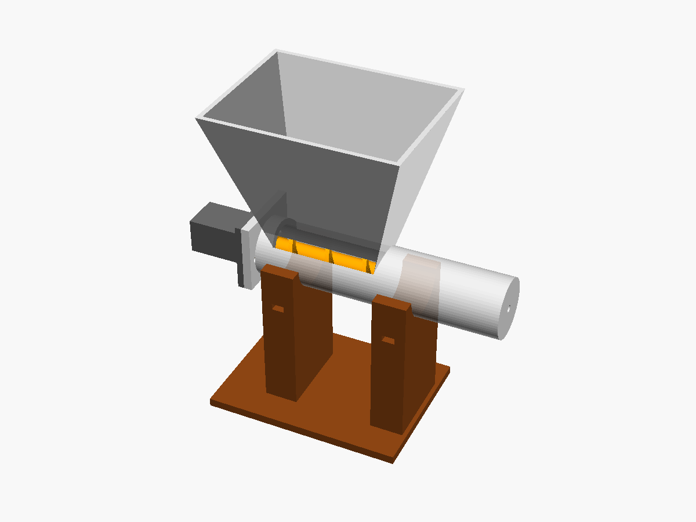

# Fase 2 · Banco de prueba del dosificador

Antes de meter todo en la carcasa, se prueba el dosificador **solo, sobre la mesa**,
con una balanza de cocina. Así se mide cuántos gramos da por vuelta y si la dosis es pareja.

## Piezas para imprimir

Están en [`mecanica/stl/`](../mecanica/stl/).

| Pieza | Archivo | Cómo imprimir |
|---|---|---|
| Tolva + tubo | `cuerpo_dosificador.stl` | Como sale (tolva hacia arriba). PETG, 0,2 mm, 3 paredes. Sin soportes. |
| Sinfín | `sinfin.stl` | **De pie**, con el cubo abajo. **Con soportes** (las aletas quedan en voladizo). PETG, 0,16 mm. |
| Soporte del motor | `soporte_motor.stl` | Como sale (tapa sobre la cama). PETG. |
| Base | `base_banco.stl` | Como sale. PLA o PETG. |

Si el sinfín sale con rebabas, lijalo: tiene que girar libre dentro del tubo (hay 0,8 mm de luz por lado).

## Lo que hay que comprar para esta fase

- 1 motorreductor **N20 de 6 V, ~100 rpm** (si podés, con **encoder**).
- 1 controlador **TB6612FNG** y 1 **ESP32-C3** (o, para empezar, una fuente de 3-6 V y un interruptor).
- 3 tornillos **M3 × 12** (2 para el soporte del motor y 1 como eje del lado del fondo).
- 2 precintos (para sujetar el tubo a la base).
- **Balanza de cocina** de 0,1 g (las de joyería sirven) y un vaso.

## Armado

1. Meté el sinfín en el tubo **por el lado de la brida** (el cubo liso queda del lado del motor).
2. Pasá el tornillo M3 por el agujero del fondo: se enrosca en el sinfín y le sirve de eje. No lo aprietes: el sinfín tiene que girar.
3. Meté el N20 en el soporte con el eje hacia la tapa. El eje en "D" entra en el agujero del cubo.
4. Atornillá el soporte a la brida con 2 M3.
5. Apoyá el tubo en las cunas de la base y sujetalo con los precintos.
6. Poné el vaso sobre la balanza, debajo de la salida.

## Prueba

1. Cargá la tolva con yerba **hasta la mitad**.
2. Hacé girar el motor **10 vueltas** (o 6 segundos a 100 rpm) y pesá. Repetí 3 veces.
3. Calculá **gramos por vuelta** = gramos / 10.
4. Anotá el valor en `GRAMOS_POR_VUELTA_MEDIDO` de [`calculos/dosificador.py`](../calculos/dosificador.py) y corrélo: te dice cuántas vueltas dan 8 g.
5. Hacé **10 dosis de 8 g** y pesá cada una. El script explica cómo sacar el CV (objetivo: **menos de 15 %**).
6. Repetí con la tolva **casi vacía** y **llena**, y con **2-3 marcas** de yerba (con y sin palo).

## Qué anotar

| Prueba | Marca de yerba | Nivel de tolva | g/vuelta | CV % | ¿Se trabó? |
|---|---|---|---|---|---|
| 1 | | | | | |

## Si algo falla

| Problema | Qué cambiar en el `.scad` |
|---|---|
| La yerba va hacia el motor en vez de a la salida | Invertí los dos cables del motor |
| Se traba con palitos | Subir `tubo_di` y `sinfin_d` 2 mm, o subir `paso` a 22 |
| La yerba hace "puente" en la tolva y no baja | Paredes más empinadas: bajar `tolva_arriba` o subir `tolva_alto` |
| Da demasiado por vuelta (poca precisión) | Bajar `paso` a 14 |
| Gotea yerba con el motor quieto | Alargar el tramo entre la entrada y la salida (`sinfin_largo`) |
| El motor no tiene fuerza | N20 con más reducción (1:298, ~50 rpm) |
