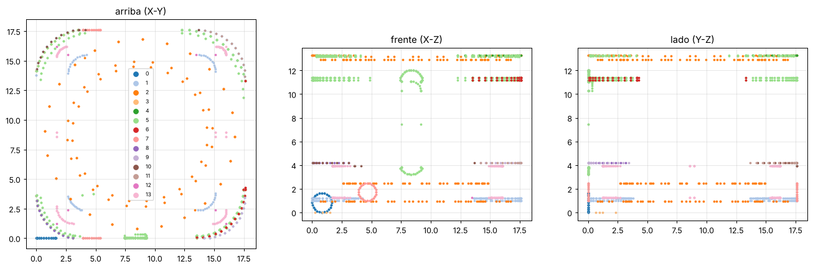

# Lo que sale del SketchUp original

Archivo: `IdeaDispositivoparamate.skp` (SketchUp 2025, unidades en centímetros).

> El archivo `.skp` **no está en este repositorio** porque el repositorio es público
> y el archivo guarda datos de la computadora donde se creó. Ver el README.

## Cómo se leyó

SketchUp usa un formato cerrado y no hay SketchUp en Linux. Por eso se extrajeron
**solo los vértices** (puntos) del archivo, sin las caras ni los nombres de las
piezas. Las medidas son **aproximadas (±2 mm)**.

## Medidas encontradas

| Qué | Medida aproximada |
|---|---|
| Forma | Caja **cuadrada con esquinas redondeadas** (no un cilindro) |
| Base | **176 × 176 mm** |
| Alto | **133 mm** |
| Radio de las esquinas (vista de arriba) | ~35 mm |
| Bordes | Redondeados (perfiles circulares de ~8-10 mm usados con "Sígueme") |

Planos horizontales (alturas de cortes o divisiones):

| Altura | Posible función |
|---|---|
| 10-12 mm | Base / piso |
| 25 mm | Piso interior |
| 39-42 mm | División (¿techo del cajón de residuos?) |
| 112-114 mm | División superior (¿base de la tapa o de la tolva?) |
| 133 mm | Tapa |

También aparece la figura humana de ejemplo de SketchUp ("Ty"), que no es parte del diseño.

## Qué se decidió

- Se usa la **medida grande** del modelo (176 × 176 mm) en lugar de la del plan (Ø80 × 120 mm), porque en Ø80 no entra un mate.
- El alto se subió de **133 a 200 mm** en el modelo paramétrico: con 133 mm no hay lugar para el tobogán de yerba sobre la boca, y el mate real (camionero, ~130 mm) necesita ~200 mm (ver [revisión técnica](revision_tecnica.md)).
- Las dos medidas son parámetros (`caja_alto`, `caja_ancho`) en [`mecanica/dispositivo_mate.scad`](../mecanica/dispositivo_mate.scad).

## Para tener el modelo completo

Si exportás desde SketchUp **Archivo → Exportar → Modelo 3D → STL u OBJ**, se pueden
leer las piezas reales con sus caras y sus nombres, y comparar con este diseño.
