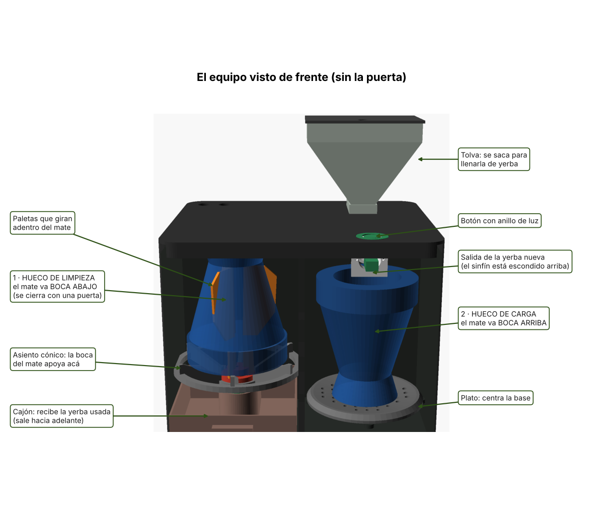
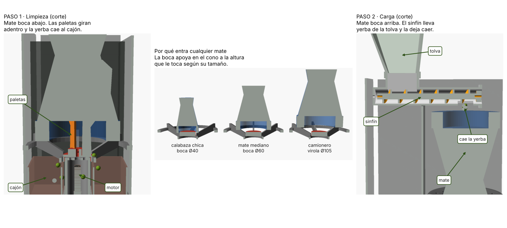

# Cómo funciona (explicado fácil)

## 1. El equipo por fuera

Es una caja negra de **27 cm de ancho, 23 cm de fondo y 22 cm de alto** (con la tolva arriba llega a 32 cm),
parecida a una cafetera. Por delante tiene **dos huecos**, uno al lado del otro:

| | Hueco izquierdo: **LIMPIEZA** | Hueco derecho: **CARGA** |
|---|---|---|
| Cómo va el mate | **Boca abajo** | **Boca arriba** |
| Dónde se apoya | En un **asiento con forma de cono** (apoya la boca) | En un **plato** con agujeritos (apoya la base) |
| Qué pasa | Unas **paletas** de goma giran adentro del mate y la yerba usada cae a un **cajón** | Un **tornillo (sinfín)** trae yerba de la **tolva** y la deja caer en la boca |
| Tapa | Tiene una **puerta**: si está abierta, no gira | No hace falta |

Arriba está el **botón** con un anillo de luz, y atrás a la derecha la **tolva**, que se saca para llenarla de yerba.

## 2. El recorrido del mate

1. **Sacás la bombilla** y ponés el mate **boca abajo** en el hueco izquierdo. Cerrás la puerta.
2. Tocás el botón: las paletas giran unos **15 segundos** (para un lado y para el otro) y la yerba usada cae al cajón.
3. La luz late en azul: **das vuelta el mate** y lo ponés **boca arriba** en el hueco derecho. Tocás el botón.
4. El sinfín gira unos **13 segundos** y deja caer **30 g** de yerba nueva en la boca.
5. Luz verde: listo para cebar.

**¿Por qué entra cualquier mate?** El asiento es un **cono hecho de costillas**. Una boca chica apoya cerca del centro
(más abajo) y una virola grande apoya más afuera (más arriba). Como es un cono, el mate **se centra solo**.
Sirve para bocas de **4 a 12,4 cm** de diámetro y mates de hasta **13 cm** de alto.
Entre las costillas queda abierto, así la yerba cae directo al cajón.

## 3. Qué es el "modelo 3D"

El modelo 3D es el **dibujo del equipo en la computadora**, pieza por pieza, con sus medidas exactas.
Sirve para tres cosas:

1. **Verlo antes de fabricarlo** (el visor 3D, las imágenes de arriba).
2. **Imprimir las piezas**: de cada pieza sale un archivo **STL**, que es lo que se carga en la impresora 3D.
3. **Cambiar medidas fácil**: está hecho en **OpenSCAD**, un programa gratis donde el dibujo se escribe con números.
   Si cambiás un número (por ejemplo el alto del mate), se recalculan todas las piezas solas.

| Archivo | Qué es | Con qué se abre |
|---|---|---|
| `mecanica/equipo_v1.scad` | El modelo completo, con todas las medidas | **OpenSCAD** (gratis, openscad.org) |
| `mecanica/stl_v1/*.stl` | Cada pieza lista para imprimir | El laminador de tu impresora (Cura, PrusaSlicer, Bambu Studio…) o cualquier visor 3D |
| `mecanica/imagenes/*.png` | Fotos del modelo | Cualquier visor de imágenes |

**Para mirarlo en tu computadora:**
1. Instalá **OpenSCAD** y abrí `equipo_v1.scad`.
2. Arriba de todo, en la línea `pieza = "ensamble";`, podés poner `"ensamble_corte"` (cortado al medio) o `"explotado"` (piezas separadas).
3. Apretá **F5** para verlo. Con el mouse lo girás.

**Para imprimir una pieza:** abrí el `.stl` de `stl_v1/` en el programa de tu impresora; ya están acostados en la
posición correcta. La tabla de [montaje](montaje.md) dice material y si lleva soportes.

**Para cambiar una medida:** abrí el `.scad`, buscá el número (están todos arriba, con comentarios en español),
cambialo, apretá **F6** y exportá el STL (*Archivo → Exportar → STL*).
