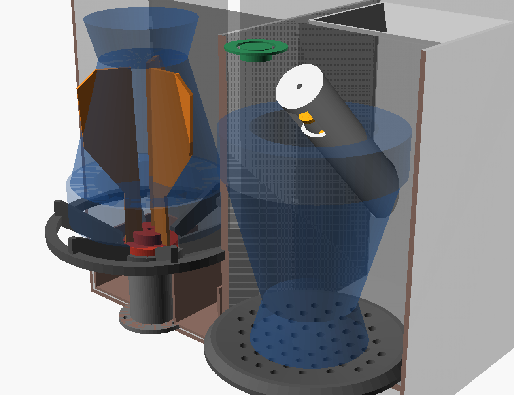

# Equipo v1 · Impresión y montaje

## 1. Imprimir

STL en [`mecanica/stl_v1/`](../../mecanica/stl_v1/), ya orientados para imprimir.

| Pieza | Material | Relleno | Soportes | Notas |
|---|---|---|---|---|
| `carcasa_izq`, `carcasa_der` | ASA o PETG negro | 15 % | No | 145 × 230 × 208 mm. Poné los 230 mm a lo largo de la cama. ~10-12 h c/u |
| `techo_izq`, `techo_der` | ASA o PETG negro | 15 % | No | Se imprimen boca abajo (cara de arriba sobre la cama). El izquierdo trae el soporte de los sensores |
| `tapa_limpieza` | PETG negro | 20 % | No | Tapa redonda de arriba; boca abajo sobre la cama |
| `tolva` | PETG **translúcido ahumado** | 15 % | No | Cilíndrica. Boca abajo (la boca de arriba sobre la cama). Translúcida para ver cuánta yerba queda |
| `tapa_tolva` | PETG negro | 20 % | No | |
| `asiento` | PETG natural | 30 % | No | |
| `cubo_rotor` | PETG natural | 100 % | No | Lleva un prisionero M3 |
| `paleta_larga` ×3, `paleta_corta` ×3 | **TPU 85-95A** | 100 % | No | Acostadas. Usá un set u otro según el mate |
| `columna_motor` | PETG natural | 30 % | No | |
| `cajon` | PETG negro | 15 % | No | El frente queda al ras de la carcasa |
| `plato` | PETG natural | 30 % | No | |
| `bandeja` | PETG (cualquier color) | 20 % | No | Sostiene pilas, placa y cargador USB-C |
| `dosificador` | PETG natural | 20 % | **Sí, solo bajo el tubo** | Tubo horizontal + cuello hacia la tolva |
| `sinfin_v1` | PETG natural | 100 % | **Sí** | De pie, 0,16 mm. Lijar hasta que gire libre |

Todas las piezas que tocan yerba van en **PETG natural (sin pigmento)**. Igual, ver
[viabilidad](viabilidad_y_produccion.md): una pieza impresa no se considera apta para alimentos.

## 2. Preparar las carcasas

1. Poné **insertos M3** con el soldador en las paredes de unión (9 por módulo) y en las repisas.
2. Atornillá los dos módulos entre sí (M3 × 12).
3. Pegá las 4 patas de silicona Ø12 en los rebajes de abajo.

## 3. Estación de limpieza (izquierda)

1. Meté el motor **JGA25-370** en la `columna_motor`, con el eje hacia arriba, y atornillalo por arriba (2 × M3 × 6).
2. Pasá los cables por la ranura de atrás de la columna y atornillá la columna al piso (3 × M3).
3. Encastrá las 3 **paletas** en el `cubo_rotor` y metelo en el eje. Apretá el prisionero M3 contra la cara plana.
4. Apoyá el `asiento` sobre las 4 repisas. Tiene que quedar **centrado con el rotor** y sin tocarlo.
5. Meté el `cajon` por el frente: la ranura en U rodea la columna.
6. Pegá el imán Ø6 × 3 en el hueco de la `tapa_limpieza` (queda del lado de atrás).
7. En el soporte que trae el `techo_izq` (atrás de la boca): pegá el **sensor Hall** en su ranura y atornillá el **microinterruptor** con 2 tornillos M2. Con la tapa puesta, el micro tiene que hacer clic. Los cables bajan a la torre por la muesca de arriba de la pared.

## 4. Estación de carga (derecha)

1. Meté el `sinfin_v1` en el tubo del `dosificador` por el lado de la brida.
2. Pasá un tornillo M3 por el agujero del extremo de atrás: se enrosca en el sinfín y hace de eje. No lo aprietes.
3. Atornillá el **N20** a la brida con el soporte del banco de prueba (`mecanica/stl/soporte_motor.stl`).
4. Con el techo sacado, bajá el dosificador por arriba: el tubo queda **horizontal sobre el plato**, con la salida justo sobre el centro. Atornillá las orejas a la pared de la torre (2 × M3).
5. Poné el `techo_der`: el cuello del dosificador asoma por el agujero.
6. Encastrá la `tolva` sobre el cuello (se apoya en el techo) y poné la `tapa_tolva`.
7. Apoyá el `plato` sobre sus repisas.

## 5. Electrónica (torre izquierda)

Seguí [conexiones.md](conexiones.md). Orden recomendado:

0. Atornillá la `bandeja` a los 4 tetones del piso de la torre (M3 × 8). Lleva el portapilas, el BMS, el cargador (con el USB-C hacia el agujero de atrás) y 4 columnas para la placa.
1. Armá la placa en el perforado: ESP32-C3, TB6612, DRV8871, MP1584, 74AHCT125 y divisor.
2. Ajustá el MP1584 a 5,0 V **antes** de conectarle nada.
3. Cargá el [firmware](../../firmware/dispositivo_mate/dispositivo_mate.ino) por USB.
4. Conectá batería, BMS y cargador USB-C. El conector USB-C va en el agujero de atrás.
5. Conectá botón y anillo LED en el `techo_der`.

## 6. Primeras pruebas

1. Abrí el monitor serie a 115200 y escribí `?`: tiene que mostrar batería y tapa.
2. Con la tolva vacía, tocá el botón dos veces seguidas: el sinfín debe girar sin trabarse.
3. **Calibración**: llená la tolva, poné un vaso en el plato sobre una balanza y mantené el botón **6 s**.
   Gira 20 vueltas. Pesá y escribí `g=<gramos/20>`.
4. Meté un mate usado boca abajo **por arriba**, poné la tapa y tocá el botón una vez.
5. Anotá los resultados en la tabla de [la Fase 2](../fase2_banco_dosificador.md).
