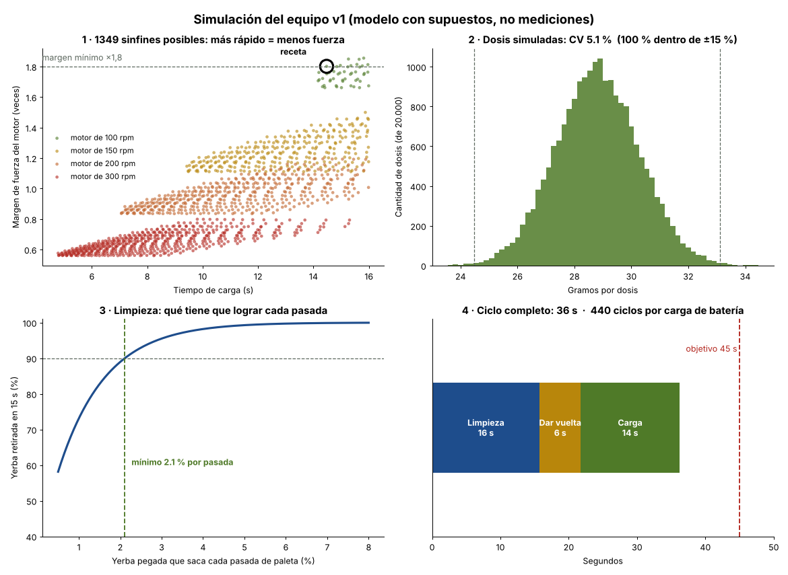

# La receta (lo que sale de la simulación)

La simulación ([`calculos/simulacion.py`](../../calculos/simulacion.py)) probó **más de 4.000 combinaciones**
de sinfín y motor, y simuló **20.000 dosis** de la mejor. Estas son las medidas y tiempos para arrancar.

> **Es un modelo, no una medición.** Usa supuestos razonables (densidad de la yerba, cuánto se llena el
> sinfín, fuerza para destrabar un palo). Sirve para elegir de dónde partir; los números reales salen de
> la prueba con balanza. Cuando midas algo, cambialo en la sección `SUPUESTOS` del script y volvé a correrlo.

## Receta de partida

### Dosificador

| Parámetro | Valor | Por qué |
|---|---|---|
| Diámetro del sinfín | **24 mm** (tubo interior 25,6 mm) | El más grande que entra entre el mate y el techo |
| Núcleo | **8 mm** | Deja un canal de 8 mm para la yerba |
| Paso | **30 mm** | Entre aletas quedan 26 mm: pasa un palo de 12 mm sin trabarse |
| Motor | **N20 de 6 V, ~100 rpm (1:298), con encoder** | Tiene ~1,8 veces la fuerza necesaria. El de 200 rpm quedaba justo (×1,0) |
| Gramos por vuelta | **~1,46 g** | A calibrar con la balanza |
| Vueltas por dosis de 30 g | **~20,5** | El programa cuenta vueltas con el encoder |
| Tiempo de carga | **~14,5 s** | |
| Variación esperada (CV) | **~5 %** (objetivo < 15 %) | 99,7 % de las dosis quedan a ±15 % |

### Limpieza

| Parámetro | Valor |
|---|---|
| Motor del rotor | JGA25-370 de 6 V, ~130 rpm |
| Paletas | 3 de TPU (set largo o corto según el mate) |
| Secuencia | **6 tramos de 2,5 s**, alternando el sentido de giro |
| Pasadas de paleta | ~88 en 15 s |
| Qué tiene que lograr | Cada pasada debe sacar **al menos el 2,1 %** de la yerba pegada para llegar al 90 % |

Ese 2,1 % es **la meta de la prueba real**: la simulación no puede saber cuánto saca una paleta de
una calabaza mojada. Si en la prueba saca menos, las opciones son más tiempo, paletas más duras o más rpm.

### Ciclo y batería

| | Valor | Objetivo |
|---|---|---|
| Ciclo completo | **~36 s** (16 s limpieza + 6 s dar vuelta + 14,5 s carga) | < 45 s ✅ |
| Energía por ciclo | ~37 mWh | |
| Ciclos por carga de batería | **~440** | ≥ 20 ✅ |
| Con 3 mates por día | Recarga cada ~4 meses | |
| Tolva | ~600 cm³ ≈ 180 g ≈ **6 cebadas** | |
| Cajón de residuos | Vaciar cada **2-3 ciclos** | |

## Qué cambió respecto del diseño anterior

| | Antes | Receta |
|---|---|---|
| Sinfín | Ø21,4 mm, paso 24 | **Ø24 mm, paso 30** |
| Motor del sinfín | N20 de 200 rpm | **N20 de 100 rpm** (más fuerza) |
| Gramos por vuelta | ~0,85-0,95 | **~1,46** |
| Tiempo de carga | ~13 s | ~14,5 s |

Ya está aplicado en el modelo 3D, los STL y el firmware.

## Orden de calibración con el equipo real

1. **Densidad**: llená un vaso medidor de 100 cm³ con tu yerba sin apretar y pesalo. Dividí por 100.
2. **Gramos por vuelta**: mantené el botón 6 s (gira 20 vueltas), pesá y escribí `g=<gramos/20>`.
3. **CV**: hacé 10 dosis y pesalas. Si el CV pasa de 15 %, bajá el paso a 26 mm.
4. **Atascos**: si se traba más de 1 vez cada 20 dosis, pasá a un motor con más reducción.
5. **Limpieza**: pesá el mate antes y después. Si saca menos del 90 %, subí `LIMPIEZA_TRAMOS` de 6 a 8.
