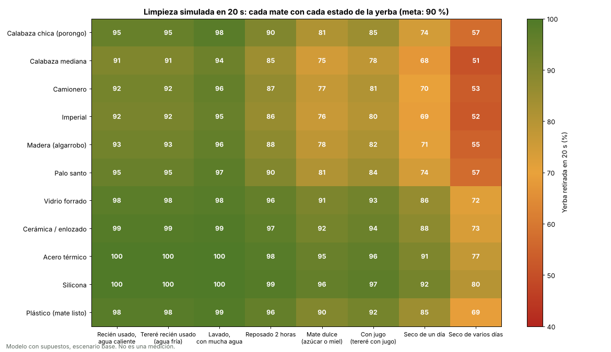
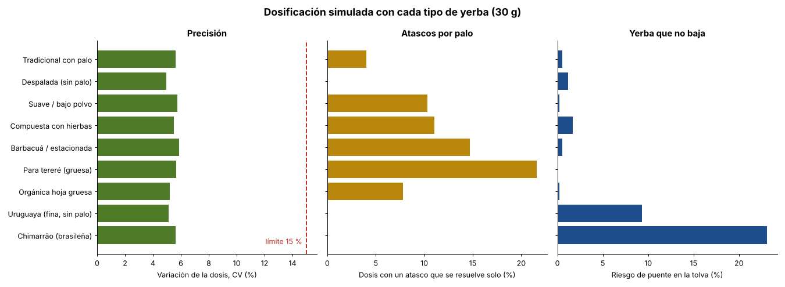

# Simulaciones con todos los mates, yerbas y aguas

Generado por [`calculos/simulacion_escenarios.py`](../../calculos/simulacion_escenarios.py). Para rehacerlo: `python calculos/simulacion_escenarios.py`.

> **Son modelos con supuestos, no mediciones.** Los catálogos de mates y yerbas usan medidas típicas.
> Lo que más vale de estas tablas es el **orden** (qué anda mejor y qué peor) y los **límites**
> (qué no entra). Los porcentajes exactos se confirman con el equipo armado.

## 1. ¿Qué mates entran?

| Mate | Boca | Ancho | Alto | ¿Entra? | Paleta | Dosis sugerida | Observaciones |
|---|---|---|---|---|---|---|---|
| Calabaza chica (porongo) | 45 mm | 75 mm | 85 mm | ✅ | corta | 18 g | — |
| Calabaza mediana | 55 mm | 90 mm | 100 mm | ✅ | corta | 26 g | — |
| Camionero | 70 mm | 105 mm | 130 mm | ✅ | larga | 40 g | — |
| Imperial | 65 mm | 100 mm | 120 mm | ✅ | media | 36 g | — |
| Torpedo | 60 mm | 85 mm | 140 mm | ❌ | larga | 36 g | boca arriba choca con la salida de yerba |
| Uruguayo boca ancha | 85 mm | 120 mm | 120 mm | ❌ | media | 54 g | no pasa por la boca de arriba (115 mm); no entra en el nicho de carga |
| Madera (algarrobo) | 50 mm | 80 mm | 95 mm | ✅ | corta | 22 g | — |
| Palo santo | 48 mm | 78 mm | 90 mm | ✅ | corta | 19 g | — |
| Vidrio forrado | 60 mm | 80 mm | 95 mm | ✅ | corta | 24 g | — |
| Cerámica / enlozado | 65 mm | 85 mm | 90 mm | ✅ | corta | 26 g | — |
| Acero térmico | 75 mm | 85 mm | 105 mm | ✅ | media | 29 g | — |
| Silicona | 62 mm | 80 mm | 85 mm | ✅ | corta | 23 g | — |
| Plástico (mate listo) | 60 mm | 75 mm | 90 mm | ✅ | corta | 22 g | — |
| Guampa (cuerno, tereré) | 55 mm | 65 mm | 150 mm | ❌ | larga | 30 g | boca abajo choca con la tapa; boca arriba choca con la salida de yerba; no se para solo (base redonda) |

**11 de 14 tipos entran sin cambios.** La dosis sugerida llena el 40 % del volumen del mate; se cambia con `d=<gramos>`.

## 2. Limpieza: mate × estado de la yerba usada

Porcentaje de yerba retirada con la limpieza **normal de 20 s** y, entre paréntesis, con la **larga de 40 s** (escenario base). Meta: **90 %**.

| Mate | Recién usado, agua caliente | Tereré recién usado (agua fría) | Lavado, con mucha agua | Reposado 2 horas | Mate dulce (azúcar o miel) | Con jugo (tereré con jugo) | Seco de un día | Seco de varios días |
|---|---|---|---|---|---|---|---|---|
| Calabaza chica (porongo) | ✅ 95 % (100 %) | ✅ 95 % (100 %) | ✅ 98 % (100 %) | ✅ 90 % (99 %) | ⚠️ 81 % (96 %) | ⚠️ 85 % (97 %) | ⚠️ 74 % (93 %) | ❌ 57 % (80 %) |
| Calabaza mediana | ✅ 91 % (97 %) | ✅ 91 % (97 %) | ✅ 94 % (98 %) | ⚠️ 85 % (95 %) | ⚠️ 75 % (91 %) | ⚠️ 78 % (93 %) | ❌ 68 % (87 %) | ❌ 51 % (73 %) |
| Camionero | ✅ 92 % (98 %) | ✅ 92 % (98 %) | ✅ 96 % (98 %) | ⚠️ 87 % (97 %) | ⚠️ 77 % (93 %) | ⚠️ 81 % (95 %) | ❌ 70 % (89 %) | ❌ 53 % (76 %) |
| Imperial | ✅ 92 % (98 %) | ✅ 92 % (98 %) | ✅ 95 % (98 %) | ⚠️ 86 % (96 %) | ⚠️ 76 % (92 %) | ⚠️ 80 % (94 %) | ❌ 69 % (88 %) | ❌ 52 % (75 %) |
| Madera (algarrobo) | ✅ 93 % (98 %) | ✅ 93 % (98 %) | ✅ 96 % (98 %) | ⚠️ 88 % (97 %) | ⚠️ 78 % (94 %) | ⚠️ 82 % (95 %) | ⚠️ 71 % (90 %) | ❌ 55 % (77 %) |
| Palo santo | ✅ 95 % (99 %) | ✅ 95 % (99 %) | ✅ 97 % (99 %) | ✅ 90 % (98 %) | ⚠️ 81 % (95 %) | ⚠️ 84 % (97 %) | ⚠️ 74 % (92 %) | ❌ 57 % (80 %) |
| Vidrio forrado | ✅ 98 % (98 %) | ✅ 98 % (98 %) | ✅ 98 % (98 %) | ✅ 96 % (98 %) | ✅ 91 % (98 %) | ✅ 93 % (98 %) | ⚠️ 86 % (97 %) | ⚠️ 72 % (90 %) |
| Cerámica / enlozado | ✅ 99 % (99 %) | ✅ 99 % (99 %) | ✅ 99 % (99 %) | ✅ 97 % (99 %) | ✅ 92 % (99 %) | ✅ 94 % (99 %) | ⚠️ 88 % (98 %) | ⚠️ 73 % (92 %) |
| Acero térmico | ✅ 100 % (100 %) | ✅ 100 % (100 %) | ✅ 100 % (100 %) | ✅ 98 % (100 %) | ✅ 95 % (100 %) | ✅ 96 % (100 %) | ✅ 91 % (99 %) | ⚠️ 77 % (94 %) |
| Silicona | ✅ 100 % (100 %) | ✅ 100 % (100 %) | ✅ 100 % (100 %) | ✅ 99 % (100 %) | ✅ 96 % (100 %) | ✅ 97 % (100 %) | ✅ 92 % (99 %) | ⚠️ 80 % (95 %) |
| Plástico (mate listo) | ✅ 98 % (99 %) | ✅ 98 % (99 %) | ✅ 99 % (99 %) | ✅ 96 % (99 %) | ✅ 90 % (98 %) | ✅ 92 % (99 %) | ⚠️ 85 % (97 %) | ❌ 69 % (89 %) |

Segundos necesarios para llegar al 90 % (promedio de todos los mates que entran):

| Estado de la yerba | Optimista | Base | Pesimista |
|---|---|---|---|
| Recién usado, agua caliente | 7 s | 15 s | 29 s |
| Tereré recién usado (agua fría) | 7 s | 15 s | 29 s |
| Lavado, con mucha agua | 5 s | 11 s | 22 s |
| Reposado 2 horas | 10 s | 20 s | 40 s |
| Mate dulce (azúcar o miel) | 14 s | 28 s | 57 s |
| Con jugo (tereré con jugo) | 12 s | 25 s | 50 s |
| Seco de un día | 18 s | 35 s | 71 s |
| Seco de varios días | 29 s | 57 s | 115 s |

✅ llega con la limpieza normal · ⚠️ llega con la limpieza larga · ❌ no llega ni con la larga.

**Lectura:** los mates **lisos** (vidrio, cerámica, acero, silicona) salen limpios casi siempre. Los **porosos** (calabaza, madera) llegan justo con yerba recién usada y necesitan la **limpieza larga** si la yerba reposó, es dulce o se secó. La yerba **seca de varios días** no sale bien de un mate poroso: ahí hay que mojarla un minuto antes o limpiar a mano. Por eso la limpieza normal pasó de 15 a 20 s.

## 3. Dosificación con cada tipo de yerba (carga de 30 g)

| Yerba | g por vuelta | Vueltas | Tiempo | Variación (CV) | Se traba y se destraba solo | Bloqueo real | Hace puente en la tolva | Cebadas por tolva |
|---|---|---|---|---|---|---|---|---|
| Tradicional con palo | 1.46 | 20 | 14 s | 5.6 % | 1 de cada 25 | 1 de cada 497 | 1 % | 5.6 |
| Despalada (sin palo) | 1.63 | 18 | 13 s | 5.0 % | casi nunca | casi nunca | 1 % | 6.2 |
| Suave / bajo polvo | 1.32 | 23 | 16 s | 5.7 % | 1 de cada 10 | 1 de cada 193 | 0 % | 5.2 |
| Compuesta con hierbas | 1.29 | 23 | 16 s | 5.5 % | 1 de cada 9 | 1 de cada 181 | 2 % | 5.0 |
| Barbacuá / estacionada | 1.36 | 22 | 16 s | 5.9 % | 1 de cada 7 | 1 de cada 136 | 1 % | 5.4 |
| Para tereré (gruesa) | 1.19 | 25 | 18 s | 5.7 % | 1 de cada 5 | 1 de cada 93 | 0 % | 4.9 |
| Orgánica hoja gruesa | 1.18 | 25 | 18 s | 5.2 % | 1 de cada 13 | 1 de cada 256 | 0 % | 4.7 |
| Uruguaya (fina, sin palo) | 1.99 | 15 | 11 s | 5.1 % | casi nunca | casi nunca | 9 % | 7.1 |
| Chimarrão (brasileña) | 2.31 | 13 | 9 s | 5.6 % | casi nunca | casi nunca | 23 % | 7.8 |

**Lectura:** todas quedan muy por debajo del 15 % de variación. Hay dos familias con problemas distintos:
- **Yerbas gruesas con palo largo** (tereré, barbacuá): más atascos. El programa retrocede y sigue.
- **Yerbas muy finas** (uruguaya, chimarrão): no se traban, pero **hacen puente en la tolva** y dan más gramos por vuelta. Para ellas hace falta un **agitador** en la tolva y recalibrar (`g=`).

## 4. Agua y residuos

| Estado de la yerba | Peso del residuo | Volumen | Agua que escurre | Vaciar el cajón cada |
|---|---|---|---|---|
| Recién usado, agua caliente | 90 g | 164 cm³ | 15 ml | 3.2 ciclos |
| Tereré recién usado (agua fría) | 78 g | 142 cm³ | 25 ml | 3.7 ciclos |
| Lavado, con mucha agua | 99 g | 180 cm³ | 40 ml | 2.9 ciclos |
| Reposado 2 horas | 87 g | 158 cm³ | 5 ml | 3.3 ciclos |
| Mate dulce (azúcar o miel) | 90 g | 164 cm³ | 12 ml | 3.2 ciclos |
| Con jugo (tereré con jugo) | 84 g | 153 cm³ | 25 ml | 3.4 ciclos |
| Seco de un día | 48 g | 87 cm³ | 0 ml | 6.0 ciclos |
| Seco de varios días | 36 g | 65 cm³ | 0 ml | 7.9 ciclos |

**Lectura:** el cajón alcanza para **3 a 5 mates** mojados. El peor caso de agua es el mate lavado (**40 ml** por ciclo): en 3 ciclos son más de 100 ml sueltos. El cajón tiene que ser **estanco** (sin la ranura abierta abajo) o llevar una **rejilla con bandeja** para el agua.

## 5. Tolerancias de impresión

Probabilidad de que una pieza impresa quede mal por el error normal de una impresora (±0,15 mm).

| Encastre | Roza o no entra | Queda flojo |
|---|---|---|
| Sinfín dentro del tubo (0,8 mm por lado) | 0.2 % | 0.0 % |
| Tapa de limpieza en su rebaje (0,3 mm) | 7.0 % | 3.9 % |
| Cajón en su boca (0,5 mm) | 3.0 % | 2.9 % |
| Eje del motor en el sinfín (0,125 mm) | 3.1 % | 3.1 % |
| Tolva sobre el cuello (0,3 mm) | 7.0 % | 3.9 % |

**Lectura:** el punto fino es el **eje del motor en el sinfín**: conviene imprimir primero una pieza de prueba chica con el agujero y ajustar `holgura` antes de imprimir el sinfín entero.

## 6. Un año de uso (3 mates por día)

| Yerba | Atascos que se resuelven solos | Bloqueos (hay que abrir) | Puentes en la tolva | Recargas de tolva | Vaciados de cajón |
|---|---|---|---|---|---|
| Tradicional con palo | 44 | 2.2 | 1 | 196 | 345 |
| Despalada (sin palo) | 0 | 0.0 | 1 | 178 | 345 |
| Suave / bajo polvo | 113 | 5.8 | 0 | 210 | 345 |
| Compuesta con hierbas | 121 | 6.0 | 2 | 217 | 345 |
| Barbacuá / estacionada | 161 | 8.0 | 1 | 202 | 345 |
| Para tereré (gruesa) | 237 | 11.8 | 0 | 226 | 345 |
| Orgánica hoja gruesa | 85 | 4.4 | 0 | 235 | 345 |
| Uruguaya (fina, sin palo) | 0 | 0.0 | 10 | 154 | 345 |
| Chimarrão (brasileña) | 0 | 0.0 | 25 | 140 | 345 |

En un año son **1095 ciclos**, **33 kg** de yerba, **2.5 cargas** de batería y solo **9 horas** de motor (los motores de este tipo duran cientos de horas).

## 7. ¿Qué cambia más la precisión de la dosis?

Variación de referencia (yerba tradicional, 30 g): **5.7 %**.

| Si cambia… | CV mínimo | CV máximo |
|---|---|---|
| Palo: 0 % a 40 % | 4.7 % | 6.3 % |
| Palo más largo: 6 a 20 mm | 5.5 % | 5.7 % |
| Polvo: 5 % a 50 % | 5.7 % | 5.9 % |
| Densidad: 0,25 a 0,40 | 5.3 % | 6.3 % |
| Dosis: 15 g a 60 g | 4.7 % | 7.3 % |

**Lectura:** lo que más pesa es el **tamaño de la dosis** (menos vueltas = menos precisión) y la **cantidad de palo**. En ningún caso se pasa del 15 %.

## Qué cambia en el diseño con todo esto

| # | Hallazgo | Qué se hace |
|---|---|---|
| 1 | El camionero y otros mates medianos quedaban entre dos paletas | **Se agrega una paleta media (85 mm)** ✅ hecho |
| 2 | Las calabazas quedaban justo por debajo del 90 % en 15 s | **La limpieza normal pasa a 20 s** ✅ hecho |
| 2b | La yerba seca y el mate dulce necesitan más | **Limpieza larga de 40 s** manteniendo el botón 2 s ✅ hecho en el firmware |
| 3 | Cada mate necesita otra dosis (18 a 40 g) | **3 tamaños de dosis** (20, 30 y 40 g) que se eligen con doble toque ✅ hecho en el firmware |
| 4 | Las yerbas finas hacen puente en la tolva | Agitador en la tolva (pendiente de diseño) |
| 5 | El agua del mate lavado se junta en el cajón | Cajón estanco o con rejilla (pendiente de diseño) |
| 6 | Torpedo, uruguayo ancho y guampa no entran | Versión alta/ancha cambiando `H` y `nicho_ancho` (pendiente) |
| 7 | El eje del motor en el sinfín es el encastre más sensible | Imprimir primero una pieza de prueba |

